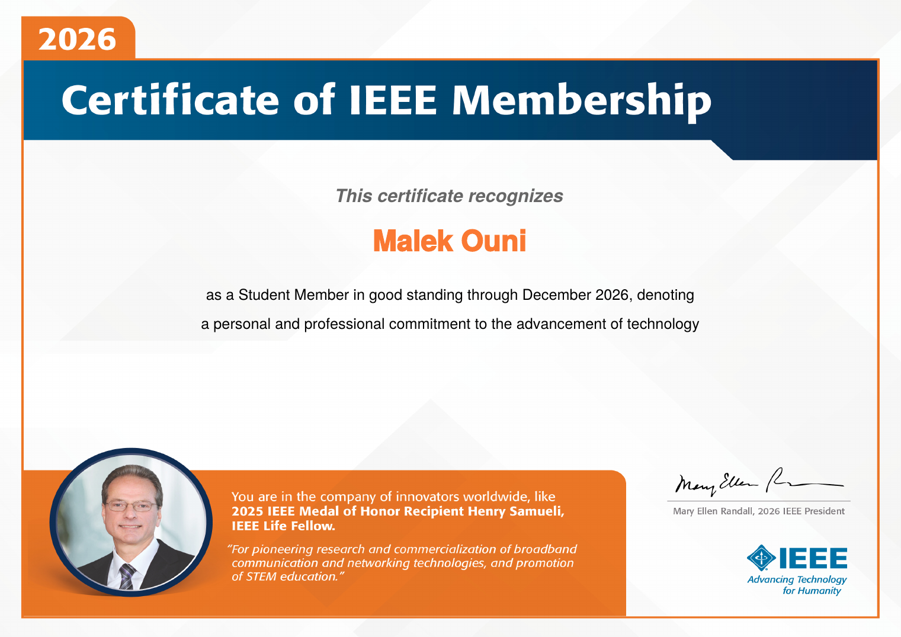
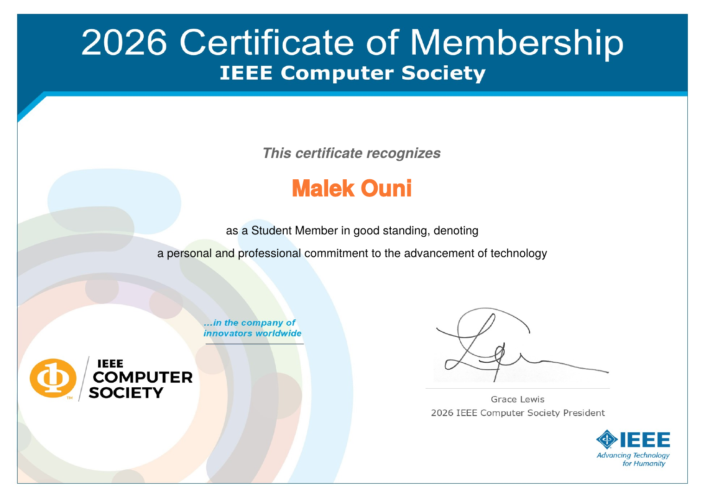
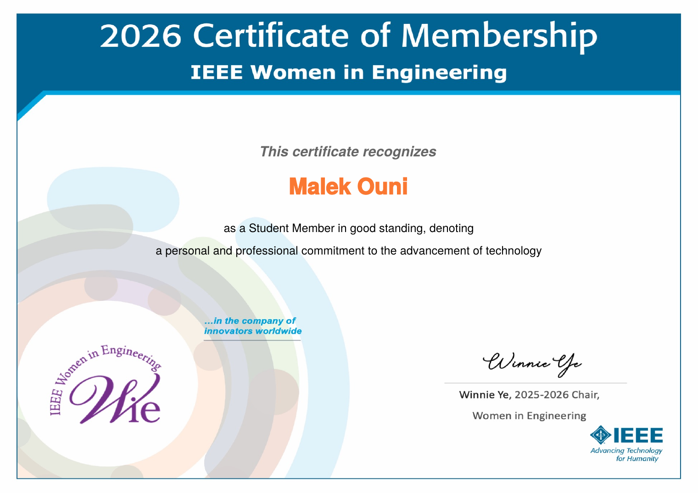
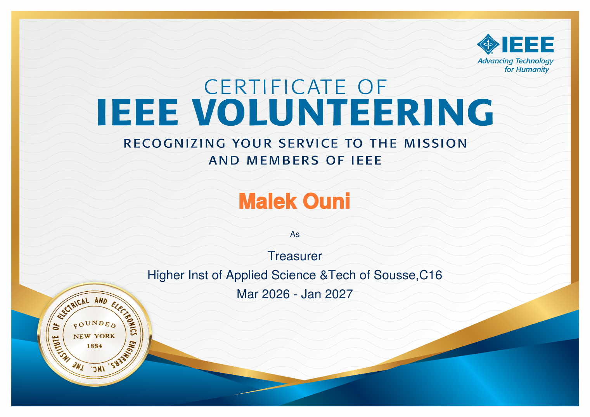
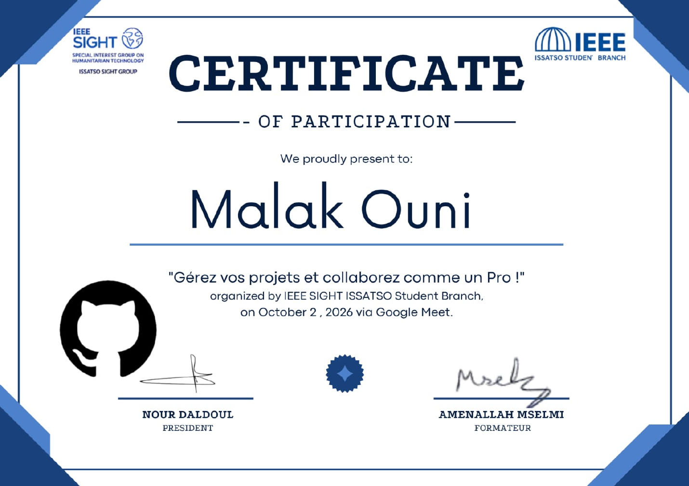

# 🎓 Certifications & Recognition

**Embedded Systems · IoT · Networks · IEEE**

---

## 📋 Overview

| # | Certificate | Issuer | Period |
|:-:|---|---|:-:|
| 1 | 🏅 **IEEE Student Membership** | IEEE | 2026 (valid through Dec 2026) |
| 2 | 💻 **IEEE Computer Society Membership** | IEEE Computer Society | 2026 |
| 3 | 👩‍💻 **IEEE Women in Engineering Membership** | IEEE Women in Engineering | 2026 |
| 4 | 🤝 **IEEE Volunteering: Treasurer** | IEEE, ISSAT Sousse | Mar 2026 – Jan 2027 |
| 5 | 🐙 **Project Management & Collaboration with GitHub** | IEEE SIGHT ISSATSO Student Branch | Oct 2, 2026 |

---

## 🏅 IEEE Memberships

<table>
  <tr>
    <td align="center" width="50%">
       
      <b>IEEE Student Membership</b> 
      Good standing through December 2026
    </td>
    <td align="center" width="50%">
       
      <b>IEEE Computer Society</b> 
      2026 Student Membership
    </td>
  </tr>
  <tr>
    <td align="center" width="50%">
       
      <b>IEEE Women in Engineering</b> 
      2026 Student Membership
    </td>
    <td></td>
  </tr>
</table>

---

## 🤝 IEEE Volunteering

**Treasurer**, IEEE Student Branch, Higher Institute of Applied Science and Technology of Sousse
 March 2026 – January 2027

---

## 🐙 Workshops & Training

**"Manage your projects and collaborate like a Pro!"** (GitHub)
 Organized by IEEE SIGHT ISSATSO Student Branch · October 2, 2026 · Google Meet

---

⭐ *More certificates will be added as I complete new courses and trainings.*

